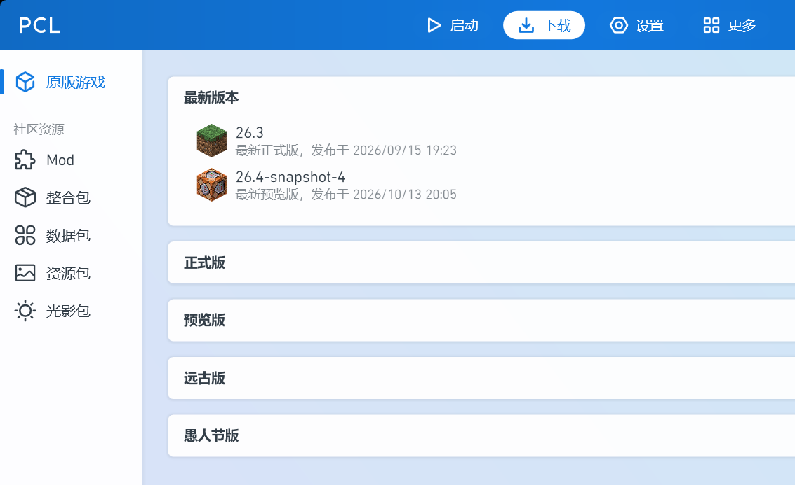

# PCL Restored · Minecraft downloads are back

> Official PCL stopped offering Minecraft downloads starting with 2.99.0.0. **This repository only does one thing: turns them back on.**
> Rebuilt from the official 2.99.0.0 source. Unofficial build, not affiliated with the original project; everything else behaves like the official launcher.

## Download & run

1. Grab `PCL-2.99.0.0-fix-win.zip` from [Releases](https://github.com/FLandreyu/MY-PCL/releases/latest);
2. Extract anywhere (portable, no installer) and run `Plain Craft Launcher 2.exe`;
3. Open the **下载 (Download)** page and install game versions, mod loaders and modpacks.

> Windows SmartScreen may warn about an unknown publisher — the exe is not code-signed. Click **More info → Run anyway**.

## What works

| Feature | Status |
| --- | --- |
| Download Minecraft releases / snapshots / ancient versions | ✅ |
| Install Forge, NeoForge, Fabric, LiteLoader, OptiFine | ✅ recommended versions in one click |
| Download and install modpacks (`.zip` / `.mrpack`, or drag & drop) | ✅ CurseForge and Modrinth packs |
| Edit installed instances (add/remove loaders, update components) | ✅ |
| Offline / third-party (authlib-injector) login | ✅ |
| Microsoft (premium) login | ⚠️ needs your own Mojang-allowlisted Entra app, see below |
| CurseForge online search | ❌ no CurseForge API key in this build; Modrinth search works |
| Auto-update | ❌ stripped from the open-source build, watch Releases instead |

## Running alongside the official launcher

Settings live in different registry keys (`HKCU\Software\PCLDebug` vs `HKCU\Software\PCL`), so both builds can coexist on one machine and share the same `.minecraft`. A common setup: official PCL for premium login and launching, this build for downloading versions and modpacks.

## Microsoft login (optional)

This repository, like the official source, ships **without a Microsoft OAuth client ID** (the official build injects one via CI secrets), so a self-built copy fails with `AADSTS900144: client_id`. To make it work you need your own Entra app approved by Mojang:

1. Register an app in the [Microsoft Entra admin center](https://entra.microsoft.com): account type *Accounts in any organizational directory and personal Microsoft accounts*, enable *Allow public client flows*;
2. Copy the *Application (client) ID* and set `PCL_MS_CLIENT_ID=<your id>` before launching (or bake it into `ModSecret.vb` and rebuild);
3. Apply for the allowlist via the [official AppID form](https://help.minecraft.net/hc/en-us/articles/16254801392141) — **login cannot complete before approval**;
4. Once approved, the same client ID works for every user of your build.

If login reaches 55% and fails with `403 Invalid app registration`, the account authorization already succeeded and only the app is unapproved — nothing to do with your network, IP or VPN. This build shows a dedicated message for that case.

## What changed

Only three things; the download engine, UI and launch logic are untouched:

- `Plain Craft Launcher 2/Modules/ModSecret.vb`: `RestrictMcDownload` flipped from `True` to `False`, restoring the download entries;
- `Plain Craft Launcher 2/FormMain.xaml.vb`: two "download removed" changelog lines deleted;
- `Plain Craft Launcher 2/Modules/Minecraft/ModLaunch.vb`: a 403 from the login API now distinguishes "app not allowlisted" from a real network error.

## License & notice

- Based on [PCL](https://github.com/Meloong-Git/PCL) 2.99.0.0 by 龙腾猫跃 (LTCat); **unofficial release**, not affiliated with the original author;
- Second-party work under the *PCL Repository Fair Use Guidelines*: original attribution and sponsor links kept, original [LICENCE](LICENCE) retained, full source published;
- For users who own Minecraft: Java Edition only. Do not use it to bypass ownership checks, sell it, or impersonate the official build;
- Provided as-is, without warranty. See [TERMS.md](TERMS.md) and [PRIVACY.md](PRIVACY.md).
